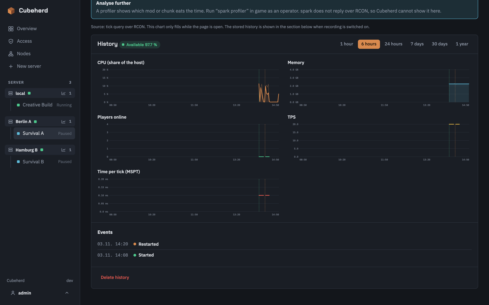
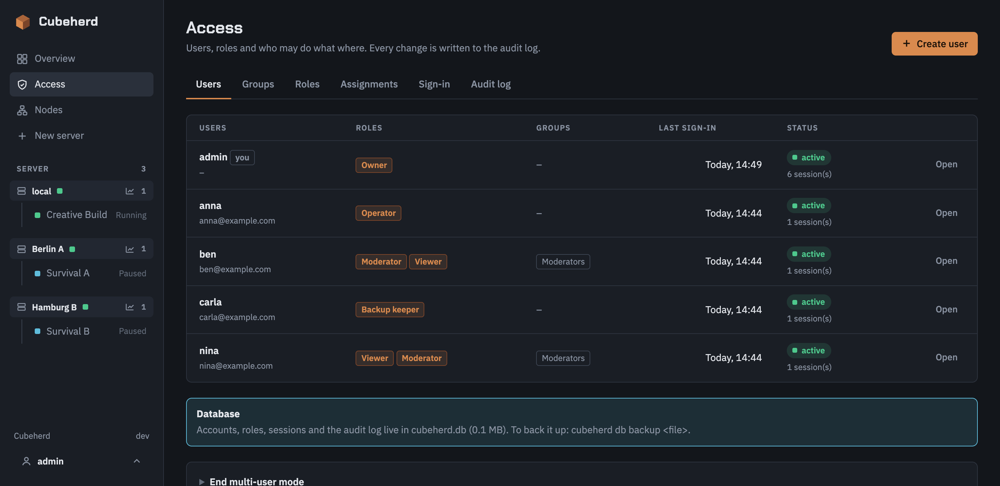
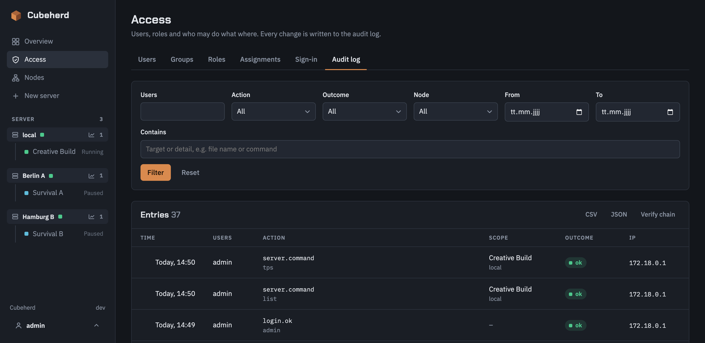

<p align="center">
  
</p>

<p align="center">
  <a href="https://github.com/matserix/cubeherd/releases"></a>
  <a href="LICENSE"></a>
  <a href="https://github.com/matserix/cubeherd/pkgs/container/cubeherd"></a>
</p>

A lean web dashboard for [itzg/docker-minecraft-server](https://github.com/itzg/docker-minecraft-server):
create, start, update, manage and uninstall Minecraft servers (including modpacks from Modrinth and CurseForge).

Cubeherd runs on the same host as the Minecraft servers and takes next to nothing from them:
a single Go binary, around 10 MB of RAM and 0 % CPU when idle. By default there is no database and live data only flows while a page is open; user accounts and statistics are optional and bring their own SQLite files.

## Screenshots

<p align="center">
  
</p>

<table>
  <tr>
    <td width="50%"><br><sub>Live console with RCON, CPU, RAM and online players</sub></td>
    <td width="50%"><br><sub>Search Modrinth, CurseForge and Spigot</sub></td>
  </tr>
  <tr>
    <td width="50%"><br><sub>Scheduled and manual backups with restore</sub></td>
    <td width="50%"><br><sub>File browser, editor and world import/export</sub></td>
  </tr>
  <tr>
    <td width="50%"><br><sub>Optional statistics: load, players and TPS over time, with events</sub></td>
    <td width="50%"><br><sub>Optional accounts: roles per node and per server</sub></td>
  </tr>
  <tr>
    <td colspan="2"><br><sub>Audit log of every sign-in and action, with filters and CSV/JSON export</sub></td>
  </tr>
</table>

## Getting started

### As a container (recommended)

```bash
sudo mkdir -p /srv/cubeherd
docker compose -f deploy/compose.yml up -d --build
```

Then open `http://<host>:8420` and set the admin password on first visit.
To manage servers on several hosts, see [Several hosts](#several-hosts).

The data directory must have **the same path** inside the container as on the host (`/srv/cubeherd:/srv/cubeherd`),
because Docker resolves the Minecraft servers' bind mounts on the host.

### As a binary

Requirement: Docker with the Compose plugin on the host.

```bash
CGO_ENABLED=0 go build -trimpath -ldflags="-s -w" -o cubeherd ./cmd/cubeherd
sudo CUBEHERD_DATA=/srv/cubeherd ./cubeherd
```

| Variable | Default | Meaning |
|---|---|---|
| `CUBEHERD_DATA` | `/srv/cubeherd` as root, otherwise `./cubeherd-data` | Data directory |
| `CUBEHERD_LISTEN` | `:8420` | Web server address |
| `DOCKER_HOST` | `/var/run/docker.sock`, falling back to `~/.docker/run/docker.sock` | Docker socket |
| `CUBEHERD_LOCAL` | `true` | Set to `false` for a dashboard that only manages remote agents (needs no Docker socket) |
| `CUBEHERD_ACCOUNTS` | `false` | `true` starts in multi-user mode (see [Users and roles](#users-and-roles)); it can also be switched on in the settings |
| `CUBEHERD_METRICS` | `false` | Record statistics on this node (see [Statistics](#statistics)); for an agent without a dashboard that could switch it on |
| `CUBEHERD_AUDIT_STDOUT` | `false` | Also print every audit entry as one JSON line to stdout, for Docker log drivers |
| `CUBEHERD_AGENT_TOKEN`, `CUBEHERD_AGENT_LISTEN` | – / `:8421` | Agent mode only, see below |
| `TZ` | `UTC` | Default time zone, as long as none is chosen in the settings |

## Several hosts

One dashboard can manage Minecraft servers on any number of hosts. The same image runs in two roles:
the **dashboard** (web UI, login, settings) and one **agent** per host (`cubeherd agent`: Docker access, server folders, backups and the scheduler).
A dashboard that also has the Docker socket keeps managing its own host as the embedded local node, so a single-host setup looks and works as before.

| Setup | Compose file |
|---|---|
| One host (dashboard and servers together) | `deploy/compose.yml` |
| Dashboard that only manages agents (no Docker socket, `CUBEHERD_LOCAL=false`) | `deploy/compose.dashboard.yml` |
| Agent on a host that runs servers | `deploy/compose.agent.yml` |

1. On each host that runs servers, start an agent with a long random token:
   `CUBEHERD_AGENT_TOKEN=$(openssl rand -base64 32 | tr -d '/+=') docker compose -f deploy/compose.agent.yml up -d`
   (the data directory needs the same path inside the container as on that host, as for the dashboard).
2. In the dashboard open **Nodes → Add node**. The dialog can generate a token and shows the compose snippet for the other host; for an agent that already runs, paste its token instead.
3. Enter the agent's address (`host:8421`) and confirm the certificate fingerprint the agent printed at startup (`docker logs`). Done.

**What the dashboard shows.** The overview, the sidebar and the new-server wizard group everything by node. Servers are addressed as `/n/<node>/s/<id>`;
the old `/servers/<id>` links keep working and point at the default node (the local one, else the first agent). Port numbers only have to be unique per node.
A node that stops answering is shown as unreachable with its last known servers and its actions disabled; its servers and scheduled backups keep running on the host.
Removing a node never touches its servers, and a removed node can be added again later.

**Settings.** Time zone, language, CurseForge key and the external backup storage are set once in the dashboard and handed to every agent (the admin password never is).
The settings page marks which section applies to all nodes, only to the dashboard, or only to the embedded node. IP addresses and the port range are per node: for the embedded node in the settings, for an agent under **Nodes → Edit**.

**How the connection is secured.** The dashboard always opens the connection, agents never call out. It is HTTPS (TLS 1.3) with a certificate the agent makes up for itself in `<data>/agent/`;
the dashboard pins its SHA-256 fingerprint when the node is added, so no certificate authority is involved. Every request also carries the bearer token; the agent stores only its hash and slows down repeated failures.
Whoever holds an agent's token controls Docker on that host, so keep port 8421 on a LAN or VPN, exactly like the dashboard. If an agent's certificate is replaced, use **Nodes → Edit → Fetch from agent** to pin the new one.

### Upgrading

- **Existing single-host installs need nothing.** The data directory format is unchanged and the first start creates the embedded node. Existing bookmarks keep working.
- **Update dashboard and agents together.** An agent whose version differs from the dashboard's is flagged "agent outdated" (still compatible, as long as the API major matches). An agent with another API major is refused with a clear message.
  Update an agent by pulling the new image on its host and recreating the container; its Minecraft servers keep running meanwhile.
- **Going back to an older release** loses the node list the next time that release saves its settings, because it does not know the `nodes` entry in `cubeherd.json`. Keep a copy of the file if you may roll back.

## Behind a reverse proxy

Terminate HTTPS in a reverse proxy and let it forward to port 8420. Cubeherd is meant for a LAN or a VPN; if people reach it from the internet, put an access layer in front as well (a VPN, Authelia, Cloudflare Access, …) and see [Security](#security).

1. The proxy must pass the original `Host` header (the CSRF check compares it with the browser's `Origin`), set `X-Forwarded-For` and `X-Forwarded-Proto`, switch off response buffering (the live console and charts stream), and allow large uploads (worlds, mods).
2. In *Settings → Reverse proxy* list the address of the proxy under **Trusted proxies**. Only from those addresses are the forwarded headers believed; the page shows the address of your current request and the client Cubeherd derives from it. Then sign-in limits and the audit log see real client addresses, and the session cookie gets the `Secure` flag over HTTPS. Without this setting the headers are ignored, so a client cannot fake its address.
3. Optionally switch on **HSTS** once HTTPS is permanent, and set the public address under *Access → Sign-in* if you use single sign-on.
4. Never put an agent (port 8421) behind the proxy or on the internet.

```nginx
location / {
    proxy_pass http://127.0.0.1:8420;
    proxy_set_header Host $host;
    proxy_set_header X-Forwarded-For $remote_addr;
    proxy_set_header X-Forwarded-Proto $scheme;
    proxy_http_version 1.1;
    proxy_buffering off;
    proxy_read_timeout 1h;
    client_max_body_size 4g;
}
```

```caddy
cubeherd.example.com {
    reverse_proxy 127.0.0.1:8420 {
        flush_interval -1
    }
}
```

```yaml
# Traefik, as labels on the cubeherd container
labels:
  - traefik.enable=true
  - traefik.http.routers.cubeherd.rule=Host(`cubeherd.example.com`)
  - traefik.http.routers.cubeherd.entrypoints=websecure
  - traefik.http.routers.cubeherd.tls.certresolver=letsencrypt
  - traefik.http.services.cubeherd.loadbalancer.server.port=8420
```

**E-mail** (multi-user mode): *Access → E-Mail* takes the SMTP server (STARTTLS, TLS or none), user, password (stored encrypted), sender, and sends a test mail. Nothing else needs it yet; features that send mail stay off until it is configured.

## Users and roles

By default Cubeherd has one shared password. For teams and communities there is an optional **multi-user mode**: personal accounts, roles, an audit log and single sign-on. Switch it on under *Settings → User accounts* (or start with `CUBEHERD_ACCOUNTS=true`). Your current password becomes the account `admin` with the Owner role and you stay signed in; nothing else changes until you add people. The data lives in one SQLite file, `cubeherd.db`, in the data directory; the servers themselves stay in their folders.

- **Rights** are fine grained: view, power, console, commands, players, settings (game rules), resources (memory and CPU), network (port and address), advanced (raw environment), update, create, delete, files (read and write), world, add-ons and four backup rights, plus suspending servers, node load (per node), node management, global settings, users, roles, sign-in providers and the audit log.
- **Roles** are sets of rights. Owner, Admin, Operator, Moderator, Customer and Viewer are built in and read-only (duplicate one to adapt it); you can create your own.
- **Assignments** give a user or a group a role on a **scope**: everything, one node (including servers created later) or one server. Rights add up, there is no deny. An assignment can expire. Rights that only exist for the whole dashboard (nodes, settings, users, roles, providers) take effect only on "Everything".
- Everything a user may not do is hidden, and the server refuses it anyway (a server the user may not see answers 404). Nobody can hand out rights they do not hold themselves, change an account with more rights than their own, or remove the last owner.
- **Audit log:** sign-ins, every change to accounts and roles, and every action on servers (start and stop, commands, file saves and downloads, backups, settings) with who, when, from where and the outcome. Refused attempts are logged too. File contents and secrets are never recorded. Entries are chained by hash (*Verify chain* finds later edits), cannot be changed in the interface, and are kept 365 days by default. Export as CSV or JSON, or stream to stdout.
- **Single sign-on** with Google or any OpenID Connect provider (Keycloak, Authentik, Authelia, Zitadel, Entra ID, Okta, …): PKCE and ID-token validation, optional e-mail domain and Workspace restriction, linking by verified e-mail, automatic account creation, and groups that follow a claim of the provider. Set the public address of the dashboard so the callback address is right when you run behind a proxy.
- **Account security** (*Access → Account security*), for dashboards that people outside your team reach:
  - **Two-factor sign-in** with any authenticator app (TOTP, QR code and 10 one-time recovery codes). Optional per user, or required for everyone or for accounts with administrative rights, with a grace period in days; after it ends the account is sent to the setup page. Codes cannot be replayed, guesses are rate limited, and an admin can reset a user who lost both device and codes. Signing in through SSO can count as the second factor.
  - **Password reset by e-mail** (needs the mail settings): a single-use link that is valid for an hour, the same answer whether or not the address exists, all sessions end afterwards, and the owner of the account gets a notice.
  - **Sign-in notices** by e-mail on a new device or on every sign-in, with a "This wasn't me" link that ends all sessions and forces a new password.
  - **Self-registration**: off, open, or open with approval by an admin (right *Approve registrations*), optionally limited to e-mail domains and with a confirmed address required. A new account gets no servers and no rights; approving only activates it. Registration is rate limited per address and has a hidden honeypot field. Set the public address so links in e-mails never come from the request's Host header.
- **Limits for hosting:** a server can have a **disk quota** (*Settings → Resources*, needs the right *Resources*) next to its memory and CPU limit. Docker cannot enforce a quota on a folder, so Cubeherd measures every minute and acts in steps: from 90 percent a warning, from 100 percent nothing more is written through Cubeherd (uploads, file saves, world import) and the server cannot start, from 120 percent a running server is stopped. Data is never deleted, and deleting files is always possible. A host can **suspend** a server (right *Suspend servers*, Owner and Admin only): it is stopped and cannot be started until it is released. The **Customer** role is meant for people who rent a server; it runs and configures the game, files, add-ons and backups but not memory, CPU, ports or raw environment. Agents need this release for the quota and suspension to hold on their node.
- **Back up** `cubeherd.db` together with `cubeherd.json` and `access.key`: `cubeherd db backup <file>` writes a consistent copy of the database. `cubeherd user reset-owner [name]` creates or repairs an owner and sets a new password (it also switches password sign-in back on); run it on the host or with `docker exec`.
- **Agents are not part of this.** An agent token still gives full control of its host. The rights protect the dashboard; do not give people access to a host or an agent token that they should not have.
- **Going back:** *Access → Users → End multi-user mode* returns to one shared password. Accounts stay in the database and are ignored. An older Cubeherd release without accounts support uses the single password again.

## Statistics

Optional history of load, players and TPS, off by default. Switch it on per node under *Nodes → Edit* (the embedded node in the same dialog), or with `CUBEHERD_METRICS=true` on an agent. Nothing runs and no file exists while it is off.

- **Recorded on the node.** Each agent (the embedded one too) samples once a minute and keeps the result in `metrics/metrics.db` in its data directory, so the history has no holes when the dashboard is down and stays with the host. The dashboard fetches charts only when you open them.
- **What:** per node CPU, memory, disk, running servers and players; per server CPU, memory, players, TPS and MSPT, plus start, stop, restart, update and crash events and the availability for the range. Player *names* and play times are not stored. TPS and the player count use RCON, so a running server gets about two to three short `rcon-cli` calls a minute; paused, stopped and starting servers are never queried, so autopause and autostop behave as before.
- **How long:** one-minute values for 48 hours, five-minute values for 30 days, hourly values for a year (each adjustable per node), capped at 256 MB by default; a full year is roughly 1.6 MB per server. Writes are batched every five minutes.
- **Where:** *Server → Performance* shows the charts below the live values (1 hour to 1 year); a node's history is under *Nodes → Statistics* (or the chart icon next to the node in the sidebar). An agent from before the feature shows a hint to update it.
- **Rights:** `stats.server` (per server) and `stats.node` (per node), separate from the live view and granted like every other right; Operator has the first, Owner and Admin both. Switching and deleting history needs `nodes.manage`.
- **Prometheus:** *Settings → Prometheus* creates a scrape token (shown once, only its hash is stored) for `GET /metrics`. It reports live values of all nodes and servers (TPS and MSPT only where the recorder is on) and reads everything, bypassing user rights, so treat it like a password.

## Security

Cubeherd has access to the Docker socket, so an administrator can in practice reach the entire host: treat that account like root.
Only expose Cubeherd on your LAN or via VPN, never directly to the internet.
By default there is a single admin account (bcrypt), with signed session cookies (`SameSite=Strict`), login throttling and CSRF protection. The [multi-user mode](#users-and-roles) adds accounts, roles and an audit log; roles keep a viewer or moderator away from the host, but anyone who may upload mods and plugins, edit files or send console commands can run code inside that server's container, so grant those rights with care.
Agents add a second entry point with the same reach as an administrator: protect their token like the admin password (see [Several hosts](#several-hosts)).

## Features

- **Create:** Vanilla, Paper, Purpur, Folia, Fabric, Quilt, Forge, NeoForge, or a modpack from Modrinth or CurseForge.
  The Java image is derived from Mojang's version data (e.g. `java25` for Minecraft 26.x).
- **Operation:** start, stop, restart, status including autopause and crash cause, live console with RCON, CPU/RAM, online players.
- **Settings:** world, RAM, Aikar flags, autopause, port, any additional itzg variables.
- **Players:** whitelist, operators, bans.
- **Updates:** Minecraft version, modpack version, itzg image.
- **Uninstall:** keep the data or delete everything.
- **Adopt** existing itzg containers (per node).
- **Several hosts:** one dashboard for any number of agents, servers grouped by node, per-node ports and addresses, clear behaviour when a node is unreachable.
- **Backups:** manual, scheduled, automatic before updates, restore, download. Optionally uploaded to S3-compatible storage (AWS S3, Backblaze B2, Hetzner, Wasabi, Cloudflare R2, MinIO), and optionally kept only there.
- **Backup checks:** every archive is read back after it is made, damaged ones are flagged, and a banner warns when backups fail or stay overdue.
- **Performance:** live TPS, tick time (MSPT), CPU and memory with a short history, per dimension on Forge and NeoForge. Queried over RCON only while the tab is open.
- **Statistics (optional):** history of node and server load, players and TPS recorded on each node, with events and availability, rights per node and server, and a Prometheus endpoint. See [Statistics](#statistics).
- **Mods & plugins:** search Modrinth, CurseForge and Spigot, add and remove entries (itzg installs them on startup), upload your own JARs.
  Also works on top of modpacks.
- **Files & worlds:** file browser with editor, upload, download and delete; export a world as a ZIP and import one.
- **Idle & limits:** pause or fully stop when nobody is playing; per-server CPU limit.
- **Language & time zone:** UI in German or English, time zone for schedules, dates and server logs.

Each server lives in the data directory as `servers/<id>/compose.yml` and can also be run with `docker compose` without Cubeherd.
See [ARCHITECTURE.md](ARCHITECTURE.md) for details on the architecture.

## Development

```bash
go run ./cmd/cubeherd          # http://localhost:8420, data in ./cubeherd-data
go test ./...
FC_PROBE=<container> go test ./internal/docker -run Live -v   # against a running itzg container
FC_NET=1 go test ./internal/sources -run Live -v               # against Mojang/Modrinth
```

The clickable design prototypes are in `prototype/index.html` and `prototype/nodes.html` (several hosts); the reasoning behind the split is in `docs/multi-node-design.pdf`.

## License

Cubeherd is licensed under the [MIT License](LICENSE). Bundled components (htmx, fonts, golang.org/x/crypto) and their
licenses are listed in [THIRD_PARTY_NOTICES.md](THIRD_PARTY_NOTICES.md). Cubeherd is not an official Minecraft product and is
not affiliated with Mojang Studios or Microsoft.
