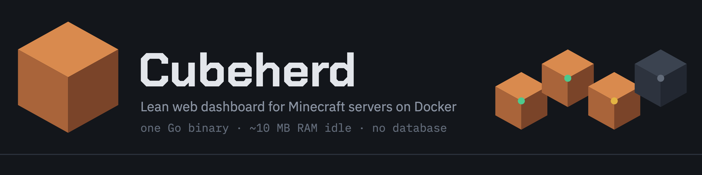
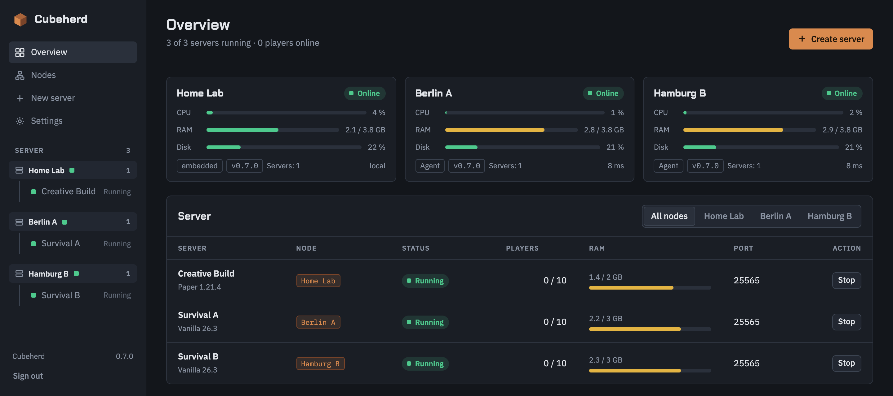
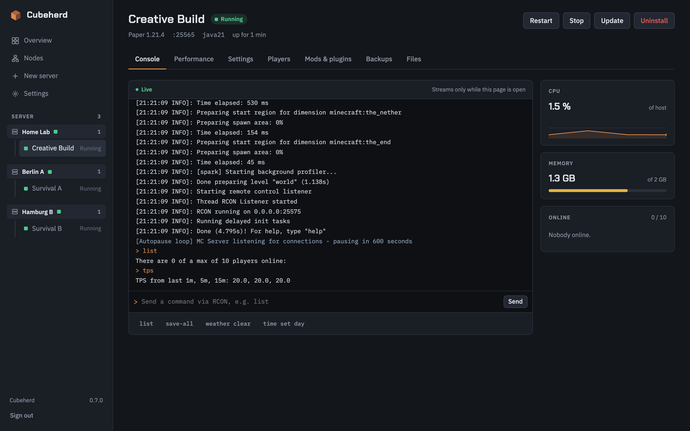
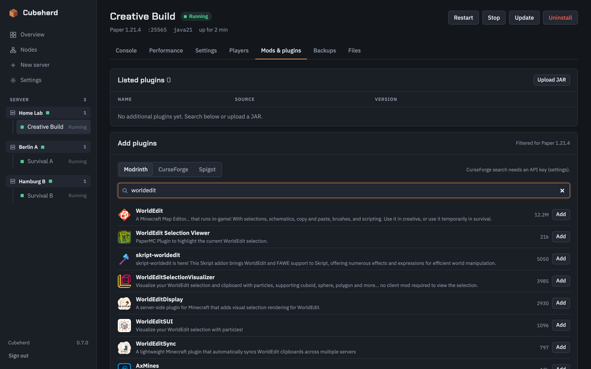
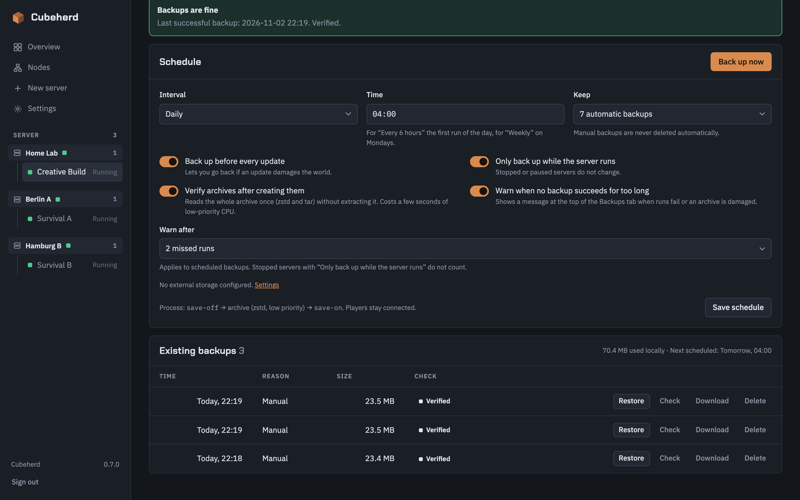
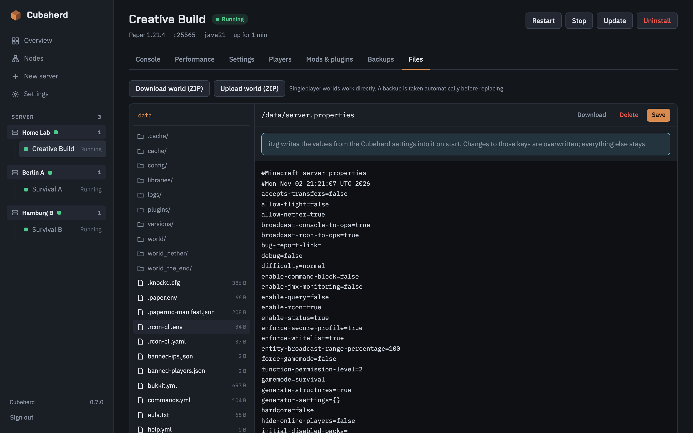

<p align="center">
  
</p>

<p align="center">
  <a href="https://github.com/matserix/cubeherd/releases"></a>
  <a href="LICENSE"></a>
  <a href="https://github.com/matserix/cubeherd/pkgs/container/cubeherd"></a>
</p>

A lean web dashboard for [itzg/docker-minecraft-server](https://github.com/itzg/docker-minecraft-server):
create, start, update, manage and uninstall Minecraft servers (including modpacks from Modrinth and CurseForge).

Cubeherd runs on the same host as the Minecraft servers and takes next to nothing from them:
a single Go binary, around 10 MB of RAM and 0 % CPU when idle, no database. Live data only flows while a page is open.

## Screenshots

<p align="center">
  
</p>

<table>
  <tr>
    <td width="50%"><br><sub>Live console with RCON, CPU, RAM and online players</sub></td>
    <td width="50%"><br><sub>Search Modrinth, CurseForge and Spigot</sub></td>
  </tr>
  <tr>
    <td width="50%"><br><sub>Scheduled and manual backups with restore</sub></td>
    <td width="50%"><br><sub>File browser, editor and world import/export</sub></td>
  </tr>
</table>

## Getting started

### As a container (recommended)

```bash
sudo mkdir -p /srv/cubeherd
docker compose -f deploy/compose.yml up -d --build
```

Then open `http://<host>:8420` and set the admin password on first visit.
To manage servers on several hosts, see [Several hosts](#several-hosts).

The data directory must have **the same path** inside the container as on the host (`/srv/cubeherd:/srv/cubeherd`),
because Docker resolves the Minecraft servers' bind mounts on the host.

### As a binary

Requirement: Docker with the Compose plugin on the host.

```bash
CGO_ENABLED=0 go build -trimpath -ldflags="-s -w" -o cubeherd ./cmd/cubeherd
sudo CUBEHERD_DATA=/srv/cubeherd ./cubeherd
```

| Variable | Default | Meaning |
|---|---|---|
| `CUBEHERD_DATA` | `/srv/cubeherd` as root, otherwise `./cubeherd-data` | Data directory |
| `CUBEHERD_LISTEN` | `:8420` | Web server address |
| `DOCKER_HOST` | `/var/run/docker.sock`, falling back to `~/.docker/run/docker.sock` | Docker socket |
| `CUBEHERD_LOCAL` | `true` | Set to `false` for a dashboard that only manages remote agents (needs no Docker socket) |
| `CUBEHERD_AGENT_TOKEN`, `CUBEHERD_AGENT_LISTEN` | – / `:8421` | Agent mode only, see below |
| `TZ` | `UTC` | Default time zone, as long as none is chosen in the settings |

## Several hosts

One dashboard can manage Minecraft servers on any number of hosts. The same image runs in two roles:
the **dashboard** (web UI, login, settings) and one **agent** per host (`cubeherd agent`: Docker access, server folders, backups and the scheduler).
A dashboard that also has the Docker socket keeps managing its own host as the embedded local node, so a single-host setup looks and works as before.

| Setup | Compose file |
|---|---|
| One host (dashboard and servers together) | `deploy/compose.yml` |
| Dashboard that only manages agents (no Docker socket, `CUBEHERD_LOCAL=false`) | `deploy/compose.dashboard.yml` |
| Agent on a host that runs servers | `deploy/compose.agent.yml` |

1. On each host that runs servers, start an agent with a long random token:
   `CUBEHERD_AGENT_TOKEN=$(openssl rand -base64 32 | tr -d '/+=') docker compose -f deploy/compose.agent.yml up -d`
   (the data directory needs the same path inside the container as on that host, as for the dashboard).
2. In the dashboard open **Nodes → Add node**. The dialog can generate a token and shows the compose snippet for the other host; for an agent that already runs, paste its token instead.
3. Enter the agent's address (`host:8421`) and confirm the certificate fingerprint the agent printed at startup (`docker logs`). Done.

**What the dashboard shows.** The overview, the sidebar and the new-server wizard group everything by node. Servers are addressed as `/n/<node>/s/<id>`;
the old `/servers/<id>` links keep working and point at the default node (the local one, else the first agent). Port numbers only have to be unique per node.
A node that stops answering is shown as unreachable with its last known servers and its actions disabled; its servers and scheduled backups keep running on the host.
Removing a node never touches its servers, and a removed node can be added again later.

**Settings.** Time zone, language, CurseForge key and the external backup storage are set once in the dashboard and handed to every agent (the admin password never is).
The settings page marks which section applies to all nodes, only to the dashboard, or only to the embedded node. IP addresses and the port range are per node: for the embedded node in the settings, for an agent under **Nodes → Edit**.

**How the connection is secured.** The dashboard always opens the connection, agents never call out. It is HTTPS (TLS 1.3) with a certificate the agent makes up for itself in `<data>/agent/`;
the dashboard pins its SHA-256 fingerprint when the node is added, so no certificate authority is involved. Every request also carries the bearer token; the agent stores only its hash and slows down repeated failures.
Whoever holds an agent's token controls Docker on that host, so keep port 8421 on a LAN or VPN, exactly like the dashboard. If an agent's certificate is replaced, use **Nodes → Edit → Fetch from agent** to pin the new one.

### Upgrading

- **Existing single-host installs need nothing.** The data directory format is unchanged and the first start creates the embedded node. Existing bookmarks keep working.
- **Update dashboard and agents together.** An agent whose version differs from the dashboard's is flagged "agent outdated" (still compatible, as long as the API major matches). An agent with another API major is refused with a clear message.
  Update an agent by pulling the new image on its host and recreating the container; its Minecraft servers keep running meanwhile.
- **Going back to an older release** loses the node list the next time that release saves its settings, because it does not know the `nodes` entry in `cubeherd.json`. Keep a copy of the file if you may roll back.

## Security

Anyone who can operate Cubeherd controls Docker and therefore, in practice, the entire host.
Only expose Cubeherd on your LAN or via VPN, never directly to the internet.
It has a single admin account (bcrypt), signed session cookies (`SameSite=Strict`), login throttling and CSRF protection.
Agents add a second entry point with the same reach: protect their token like the admin password (see [Several hosts](#several-hosts)).

## Features

- **Create:** Vanilla, Paper, Purpur, Folia, Fabric, Quilt, Forge, NeoForge, or a modpack from Modrinth or CurseForge.
  The Java image is derived from Mojang's version data (e.g. `java25` for Minecraft 26.x).
- **Operation:** start, stop, restart, status including autopause and crash cause, live console with RCON, CPU/RAM, online players.
- **Settings:** world, RAM, Aikar flags, autopause, port, any additional itzg variables.
- **Players:** whitelist, operators, bans.
- **Updates:** Minecraft version, modpack version, itzg image.
- **Uninstall:** keep the data or delete everything.
- **Adopt** existing itzg containers (per node).
- **Several hosts:** one dashboard for any number of agents, servers grouped by node, per-node ports and addresses, clear behaviour when a node is unreachable.
- **Backups:** manual, scheduled, automatic before updates, restore, download. Optionally uploaded to S3-compatible storage (AWS S3, Backblaze B2, Hetzner, Wasabi, Cloudflare R2, MinIO), and optionally kept only there.
- **Backup checks:** every archive is read back after it is made, damaged ones are flagged, and a banner warns when backups fail or stay overdue.
- **Performance:** live TPS, tick time (MSPT), CPU and memory with a short history, per dimension on Forge and NeoForge. Queried over RCON only while the tab is open.
- **Mods & plugins:** search Modrinth, CurseForge and Spigot, add and remove entries (itzg installs them on startup), upload your own JARs.
  Also works on top of modpacks.
- **Files & worlds:** file browser with editor, upload, download and delete; export a world as a ZIP and import one.
- **Idle & limits:** pause or fully stop when nobody is playing; per-server CPU limit.
- **Language & time zone:** UI in German or English, time zone for schedules, dates and server logs.

Each server lives in the data directory as `servers/<id>/compose.yml` and can also be run with `docker compose` without Cubeherd.
See [ARCHITECTURE.md](ARCHITECTURE.md) for details on the architecture.

## Development

```bash
go run ./cmd/cubeherd          # http://localhost:8420, data in ./cubeherd-data
go test ./...
FC_PROBE=<container> go test ./internal/docker -run Live -v   # against a running itzg container
FC_NET=1 go test ./internal/sources -run Live -v               # against Mojang/Modrinth
```

The clickable design prototypes are in `prototype/index.html` and `prototype/nodes.html` (several hosts); the reasoning behind the split is in `docs/multi-node-design.pdf`.

## License

Cubeherd is licensed under the [MIT License](LICENSE). Bundled components (htmx, fonts, golang.org/x/crypto) and their
licenses are listed in [THIRD_PARTY_NOTICES.md](THIRD_PARTY_NOTICES.md). Cubeherd is not an official Minecraft product and is
not affiliated with Mojang Studios or Microsoft.
